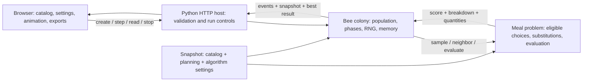

# Architecture

The app separates meal knowledge, stochastic search, host controls, and presentation. All optimization and scoring execute on the Python host.

## Public interfaces

- **Meal evaluation:** a catalog, planning inputs and a 20-choice schedule produce a score, daily menus, totals and target violations. It also supplies valid sampling and neighboring schedules to the colony.
- **Colony advancement:** explicit advancement requests produce observable events and a state snapshot. The colony owns the seeded random generator, source counters, selection, stopping and independent best-ever memory.
- **HTTP controls:** create a run, advance it, read its state, stop it or delete it. Reading state does not advance the search. Each run has its own input snapshot and state.
- **Browser configuration:** save/import/export catalog and settings. Submit run snapshots to the host and render responses. Playback timing changes the rate of advancement requests, while each stochastic decision stays on the host.

The meaningful automated tests exercise these public interfaces. Worked fixtures check meal calculations. Colony events reveal acceptance, selection, failure counts and scouts without tests reaching into private methods. HTTP checks verify control semantics and run isolation.

## Data and quantities

Component nutrition, cost and ingredient amounts describe one serving. Daily serving counts determine school cost and purchasing quantities. Preparation uses explicit batch sizes and person-minutes per batch.

Ingredient aggregation keeps each identifier/unit pair separate. Configured dietary exclusions filter candidate choices before initialization. Soft target violations remain visible even when the optimizer stops with its best result.

## Static interface

The colony laboratory, school/catalog editor and teaching guide use local assets. Configuration is remembered per browser and can be transferred through JSON. Each created run keeps a snapshot of its inputs, so later catalog edits do not change that run.

The lab records its active host run in session storage. Reset deletes it; a lab page reload or return from the editor deletes the previous run before loading saved configuration. There is no background optimizer thread: host state changes only through advance or stop requests. The in-memory registry is limited to 32 runs and expires entries after one hour without requests.

Results can be exported using the host's evaluated data. JSON retains reproducibility inputs; CSV exposes menus and purchasing quantities. The browser formats and downloads these results.

## uv and Python

Python 3.11 remains the runtime baseline. uv manages the locked environment. The startup command accepts host and port arguments; binding to a LAN-accessible address lets other devices use the same Python host.

See the [integration contract](../.scratch/mbg-school-meals/contract.md) for transport fields and the [algorithm guide](algorithm.md) for scoring and search semantics.
